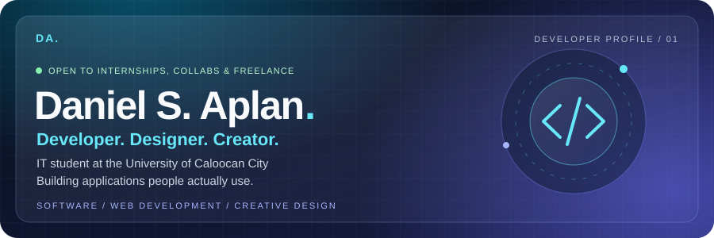
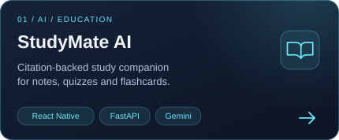
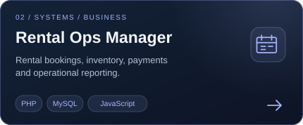
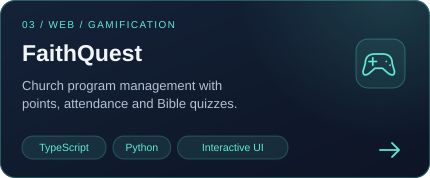
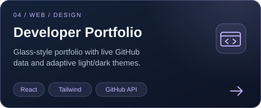

  

  

## 01 / Beyond the code

Hey, I'm **Daniel**, an Information Technology student at the **University of Caloocan City**. I'm passionate about software and web development, especially building applications that real people can pick up and use. I care about clean interfaces, a solid foundation underneath, and making my work look as good as it runs.

| Development | Creative work | Availability |
| :--- | :--- | :--- |
| React, Node.js & PHP | Photoshop, Illustrator & Lightroom | Internships, collaborations & freelance projects |

## 02 / Selected work

<table width="100%">
<tr>
<td width="50%" valign="top">
 
<a href="https://github.com/danielaplan/Studymate-AI">Source code ↗</a>
</td>
<td width="50%" valign="top">
 
<a href="https://github.com/danielaplan/Rental-Ops-Manager">Source code ↗</a>
</td>
</tr>
<tr>
<td width="50%" valign="top">
 
<a href="https://github.com/danielaplan/FaithQuest">Source code ↗</a> · <a href="https://faith-quest-zeta.vercel.app">Live demo ↗</a>
</td>
<td width="50%" valign="top">
 
<a href="https://github.com/danielaplan/PortFolio">Source code ↗</a> · <a href="https://port-folio-gamma-dusky.vercel.app/#projects">Live demo ↗</a>
</td>
</tr>
</table>

[Explore all repositories →](https://github.com/danielaplan?tab=repositories) &nbsp;·&nbsp; [View full portfolio →](https://port-folio-gamma-dusky.vercel.app/#projects)

## 03 / Technology dashboard

<table width="100%">
<tr><td width="50%" valign="top">
<strong>Frontend development</strong>  

</td><td width="50%" valign="top">
<strong>Backend &amp; databases</strong>  
 

</td></tr>
<tr><td valign="top">
<strong>Programming languages</strong>  

</td><td valign="top">
<strong>Creative design</strong>  
 

</td></tr>
<tr><td colspan="2" valign="top">
<strong>Developer tools &amp; platforms</strong>  
 

</td></tr>
</table>

## 04 / Development activity

  
  
    
  

Achievements, profile views &amp; daily inspiration

 

  
    
  
    
  

## 05 / Let's connect

Interested in building something together? I'm open to internships, collaborations, and freelance projects.

  

