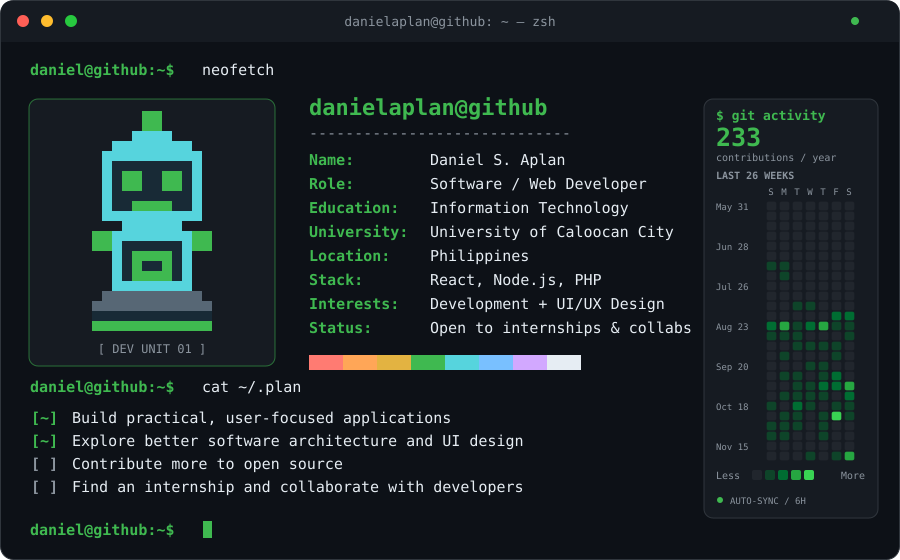
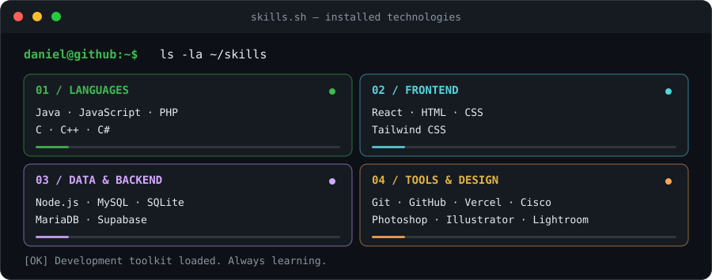
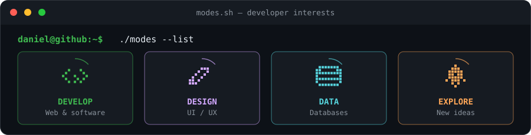
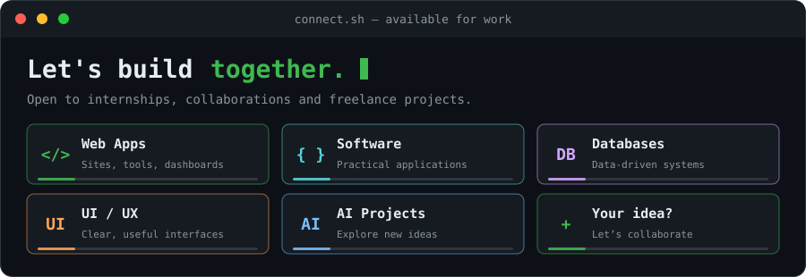

<!-- Animated terminal profile. Design inspiration: hereisVaibhav/termfolio. -->
<div align="center">
  
  

  [](https://port-folio-gamma-dusky.vercel.app/#projects)
  [](https://www.linkedin.com/in/daniel-aplan-5ba561334)
  [](mailto:danielaplan.bsit2024@gmail.com)
  [](https://www.facebook.com/daniel.aplan.9)
  [](https://www.instagram.com/dniel_apln)

  <a href="#whoami">whoami</a> · <a href="#skills">skills</a> · <a href="#projects">projects</a> · <a href="#stats">stats</a> · <a href="#connect">connect</a>
</div>

---

### whoami

I'm **Daniel S. Aplan**, an Information Technology student at the **University of Caloocan City**. I enjoy building practical software and web applications, combining clean interfaces with a solid technical foundation. I'm open to internships, freelance work and collaborations.

#### `developer.id`

<div align="center">
  
</div>

---

### skills



<div align="center">
  
  <br/>
  
  
  
</div>



---

### projects

`$ tree ~/projects`

| `~/projects` | Repository |
| :--- | :--- |
| `01` | [PortFolio](https://github.com/danielaplan/PortFolio) |
| `02` | [Rental-Ops-Manager](https://github.com/danielaplan/Rental-Ops-Manager) |
| `03` | [Studymate-AI](https://github.com/danielaplan/Studymate-AI) |
| `04` | [Daywise](https://github.com/danielaplan/Daywise) |
| `05` | [FaithQuest](https://github.com/danielaplan/FaithQuest) |
| `06` | [Messiah-Baptist-Church-Official-Website](https://github.com/danielaplan/Messiah-Baptist-Church-Official-Website) |

[Browse all repositories →](https://github.com/danielaplan?tab=repositories)

---

### stats

`$ ./github-stats --live`

<div align="center">
  
  
  <br/>
  
</div>

#### `achievements`

<div align="center">
  
</div>

---

### connect



<div align="center">

  [](mailto:danielaplan.bsit2024@gmail.com)
  [](https://port-folio-gamma-dusky.vercel.app/#projects)

  
  <br/>
  
</div>

```sh
daniel@github:~$ exit
# Session ended. Thanks for stopping by!
```

<sub>Terminal design inspired by <a href="https://github.com/hereisVaibhav/termfolio">termfolio</a> by hereisVaibhav. Custom SVG artwork and profile content.</sub>
